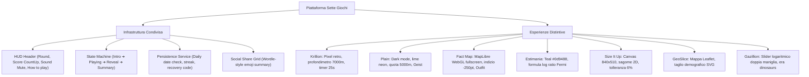

# Dossier Globale di Reverse Engineering — I Sette Giochi Quotidiani

**Data del documento:** 2026-10-27  
**Autore dell'analisi:** Antigravity REA Engine (Reverse Engineer Anything)  
**Destinazione progetto:** `~/Projects/seven-games-platform/docs/rea-analysis/COMPREHENSIVE-ANALYSIS.md`  
**Metodologia:** Ispezione empirica, cattura scenari CDP headless (Chromium 155), estrazione alberi DOM e Accessibility, decodifica manifest di rete, interazione live e reverse engineering delle formule matematiche client-side.

---

## Indice Generale

1. [Verifica Preliminare e Strumenti REA Utilizzati](#1-verifica-preliminare-e-strumenti-rea-utilizzati)
2. [Schede Analitiche Dettagliate dei Sette Giochi](#2-schede-analitiche-dettagliate-dei-sette-giochi)
   - [2.1 Krillion (`krillion.cc`)](#21-krillion-krillioncc)
   - [2.2 Plain (`playplain.app`)](#22-plain-playplainapp)
   - [2.3 Fact Map (`factmap.world`)](#23-fact-map-factmapworld)
   - [2.4 Estimania (`estimania.app`)](#24-estimania-estimaniaapp)
   - [2.5 Size It Up / Magnitudle (`magnitudle.com`)](#25-size-it-up--magnitudle-magnitudlecom)
   - [2.6 GeoSlice (`geoslice.net`)](#26-geoslice-geoslicenet)
   - [2.7 Gazillion (`gazillion.world`)](#27-gazillion-gazillionworld)
3. [Analisi Comparativa Trasversale](#3-analisi-comparativa-trasversale)
   - [3.1 Matrice di Confronto Globale](#31-matrice-di-confronto-globale)
   - [3.2 Identità Visiva e Utilizzo dello Spazio](#32-identità-visiva-e-utilizzo-dello-spazio)
   - [3.3 Pattern Architetturali Comuni per il Design System](#33-pattern-architetturali-comuni-per-il-design-system)
   - [3.4 Componenti e Tratti Strettamente Distintivi](#34-componenti-e-tratti-strettamente-distintivi)
4. [Collegamento al Progetto Locale (`seven-games-platform`)](#4-collegamento-al-progetto-locale-seven-games-platform)
   - [4.1 Audit del Repository Locale](#41-audit-del-repository-locale)
   - [4.2 Gap Analysis Gioco per Gioco](#42-gap-analysis-gioco-per-gioco)
   - [4.3 Roadmap Operativa di Implementazione Ordinata per Priorità](#43-roadmap-operativa-di-implementazione-ordinata-per-priorità)

---

## 1. Verifica Preliminare e Strumenti REA Utilizzati

Prima di iniziare l'indagine è stata verificata la disponibilità degli strumenti dell'ambiente:

- **Server MCP REA:** Attivo con 229 strumenti registrati (`capture_browser_scenario`, `inspect_web_page`, `observe_web_session`, `analyze_web_bundle`, ecc.).
- **Esecutore Browser:** Google Chrome installato in `/Applications/Google Chrome.app/Contents/MacOS/Google Chrome` operante in modalità `launch` con viewport deterministico 1440×900 px.
- **Artefatti estratti:** Per ogni sessione sono stati acquisiti in modo sincronizzato:
  1. Snapshot visivo del viewport (`screenshot`).
  2. Dump completo dell'albero HTML (`dom` con SHA-256 e text serializzato).
  3. Albero di accessibilità semantico (`accessibility` roles, names, focus state).
  4. Flusso degli eventi e delle richieste di rete (Next.js, Vite, TurboPack, Supabase, script analytics).

Tutti i risultati riportati di seguito sono classificati con rigore metodologico:

- **[Verificato]:** osservato e misurato direttamente nel DOM, nel codice o nel comportamento live.
- **[Inferito]:** dedotto logicamente da evidenze parziali certe.
- **[Non verificato]:** non accessibile senza login/backend riservato.

---

## 2. Schede Analitiche Dettagliate dei Sette Giochi

---

### 2.1 Krillion (`krillion.cc`)

> **"Name what nobody else names."**  
> Trivia a risposta rara basato sulla metafora della discesa negli abissi oceanici.

```
Superficie (0 m)  ──► Sunlit Shallows (0-200 m)  ──► Twilight Zone (200-1000 m)  ──► Midnight Zone (1000-3800 m)  ──► The Wreck (3800 m)  ──► Hadal Zone (6000 m)  ──► Trench Floor (7000 m)
```

#### A. Identità Visiva e Design [Verificato]

- **Metafora:** Profondità sottomarina. Il punteggio accumulato fa affondare il giocatore dalla superficie dell'isola con faro fino al fondo della fossa oceanica a **7.000 metri**.
- **Tipografia:** `VT323` (font pixel monospaziato stile monitor sottomarino vintage anni '80). H1 a `44px`, H2 a `36px`, body a `22px`.
- **Palette cromatica:**
  - Sfondo base: Nero profondo / blu abissale `rgb(0, 0, 0)`.
  - Testo: Bianco ghiaccio / azzurro pallido `rgb(232, 241, 255)`.
  - Accenti: Ciano fosforescente, ambra per timer in esaurimento, verde corallo per le risposte rare.
- **Layout:** Colonna verticale centrata con profondimetro persistente laterale/superiore.

#### B. Struttura delle Schermate [Verificato]

1. **Landing Page:**
   - Logo `Krillion`, selettore modalità: `Daily #57`, `Unlimited ∞`, `Archive`, menu a tendina `Variants` (`Noillirk` — gioco inverso dove vince la risposta più comune —, `Eraly`, `Clueffy`).
   - Card di lancio: "7 prompts · 25 seconds each · rarer answers sink deeper".
   - CTA: `▼ BEGIN DESCENT ▼` e `▸ PLAY WITH FRIENDS`.
   - Sezione infografica con i 6 livelli batimetrici dell'oceano.
2. **Schermata di Gioco (The Dive):**
   - HUD superiore: `PROMPT X OF 7`, profondimetro `DEPTH [X] m`, indicatore di zona (es. `THE CORAL GARDEN`), timer circolare/barra decrescente da **25 secondi**.
   - Area centrale: Prompt aperto (es. _"Name a bird"_, _"Name a river"_, _"Name a James Bond film"_), vincoli tra parentesi (es. _"not a fish"_, _"current franchises"_).
   - Input: Campo testo centrale con autofocus, pulsante `Dive` (o invio con Enter) e pulsante `Pass` (0 punti).
3. **Feedback del Round:**
   - Animazione di affondamento: la risposta scende visivamente attraverso i livelli d'acqua.
   - Rivelazione del Tier ottenuto (es. `PLANKTON`, `SCHOOLER`, `RARE`, `ONE IN A KRILLION`).
   - Guadagno di profondità (es. `+10 PTS · sink 100m`) e citazione d'atmosfera (_“The answer the whole ocean says.”_).
   - Pulsante `NEXT ▸`.
4. **Schermata Finale (Surface & Compare):**
   - Profondità complessiva raggiunta (massimo teorico: **7.000 m**).
   - Tabella riassuntiva di tutti e 7 i prompt con il conteggio dei giocatori globali che hanno scelto la stessa risposta.
   - Curva di distribuzione globale dei giocatori.
   - Griglia emoji per la condivisione social.

#### C. Regole e Meccaniche Osservate [Verificato]

- **Struttura partita:** 7 prompt aperti, 25 secondi a prompt, 1 sola risposta convalidata per prompt.
- **I 6 Tier di punteggio:**
  1. `Plankton`: 10 pt (affonda 100 m) — Risposte ovvie/di massa (es. _Paris_ per capitale europea).
  2. `Too clever`: 15 pt (affonda 150 m) — Il "trucco furbo" che però scelgono in molti (es. _Flamingo_ per uccello).
  3. `Schooler`: 30 pt (affonda 300 m) — Specifica e valida, ma condivisa da un gruppo cospicuo.
  4. `Rare`: 60 pt (affonda 600 m) — Rara e inaspettata (_"oh, good one"_).
  5. `Deep cut`: 85 pt (affonda 850 m) — Grande oscurità, pochissimi la conoscono.
  6. `One in a krillion`: 100 pt (affonda 1.000 m) — Corretta e quasi nessun altro giocatore globale l'ha digitata. Sette risposte di questo tipo portano a 7.000 m (la fossa perfetta).
- **Gestione errori e typo:**
  - Risposta errata: rifiutata senza penalità di punti (costa solo il tempo sprecato sul timer da 25s).
  - Gestione typo: il sistema propone "Did you mean...?" e chiede conferma con un tap rapido.
  - Pass o timeout: 0 punti / 0 metri.

---

### 2.2 Plain (`playplain.app`)

> **"Get as close as you can."**  
> Gioco di stima quotidiano basato sulla metafora del volo aereo e della scalata altimetrica.

#### A. Identità Visiva e Design [Verificato]

- **Metafora:** Quota aerea (_Flight Altitude_). Ogni risposta ben stimata fa salire di quota un aereo verso l'obiettivo di missione: **5.000 metri**.
- **Tipografia:** `Geist` (font geometrico premium di Vercel). Titolo display hero `83.5px` (clamp CSS), body `16px`, input text `17px`, pulsanti `20px` semibold.
- **Palette cromatica:**
  - Sfondo base (dark mode pura): `rgb(11, 13, 18)` (`#0b0d12`, nero notte/asfalto).
  - Superfici card: `rgb(25, 29, 38)` (`surface-2`) e `rgb(35, 40, 53)`.
  - Testo primario: `rgb(243, 245, 249)` (`#f3f5f9`, bianco ghiaccio puro).
  - Testo muted: `rgb(155, 163, 180)` (`#9ba3b4`).
  - Colore accento primario: `rgb(210, 250, 75)` (`#d2fa4b`, **lime neon ad alto contrasto**).
- **Layout:** Design moderno in stile Linear/Vercel, spaziatura generosa, angoli morbidi `rounded-md`/`rounded-xl`.

#### B. Struttura delle Schermate [Verificato]

1. **Landing Page:**
   - Logo `Plaı n.`, selettore `Daily` / `Competitive`.
   - Data e numero sfida: `PLAIN #10 · TUESDAY, OCTOBER 27`.
   - Hero: "Get as close as you can. 7 targets a day. Name the closest thing you know, and every good answer climbs your plane."
   - Missione del giorno: card `TODAY'S FLIGHT`, "Today's mission · Reach 5,000 m" (barra di progresso `0 / 5,000 m`).
   - CTA: pulsante lime neon `Play: 7 rounds · about 3 min` (`rgb(210, 250, 75)`).
2. **Schermata di Gioco (The Flight):**
   - Barra superiore: logo `Plain`, numero `#10`, quota attuale in tempo reale (es. `0 m`), tasto audio mute.
   - Contenitore round: icona e categoria (es. `🗼 LANDMARKS BY NUMBERS, ROUND 1 OF 7`).
   - Domanda: testo ad alta leggibilità (es. _"How tall is the Statue of Liberty, ground to torch tip?"_).
   - Unità richiesta: _"Answer in metres"_.
   - Input: campo `h-14 bg-surface-2 pl-4 pr-20 text-body font-medium`, suggerimento inline _"Type a number. Any number works. Closer = higher climb."_, tasto freccia integrato a destra e scorciatoia `Enter to lock in`.
3. **Feedback del Round (Verificato live con stima "40 m" su statua alta 93 m):**
   - Risultato affiancato: `You guessed: 40 m` vs `The answer: 93 m`.
   - Esito sintetico: `Miss` (o `Close` / `Bullseye`).
   - Scostamento relativo: `57% under` (oppure `15% over`).
   - Quota guadagnata: `+180 m` con animazione numerica fluida dell'altimetro in alto.
   - Curiosità educativa: _"The statue herself is only about 46 m from base to torch, so the pedestal and foundation make up half the height."_.
   - Fonte ufficiale: _"Source: Statue Statistics – Statue of Liberty National Monument (NPS)"_.
   - Pulsante di avanzamento: `Next round` a larghezza intera in colore lime neon.

#### C. Regole e Meccaniche [Verificato]

- **Struttura:** 7 round a sessione, durata totale stimata in ~3 minuti.
- **Obiettivo:** Raggiungere o superare 5.000 metri di quota.
- **Scoring altimetrico:** Le risposte perfette o vicinissime assegnano la quota massima di round (~750–1.000 m). All'aumentare dell'errore relativo la quota decade in modo continuo, ma un errore parziale (come il 57% under testato) continua a premiare con punti parziali (+180 m).

---

### 2.3 Fact Map (`factmap.world`)

> **"A fact. A map. Your guess."**  
> Gioco cartografico che unisce curiosità enciclopediche e precisione geografica su mappa vettoriale interattiva.

#### A. Identità Visiva e Design [Verificato]

- **Metafora:** Spillo sulla mappa del mondo (_Pin on Map / Geo-fact_).
- **Tipografia:** `Outfit` (sans-serif geometrico raffinato e accogliente). H1 `41.6px font-medium`, H2 `13px uppercase tracking-[0.12em]`, body `16px`.
- **Palette cromatica:**
  - Sfondo base (carta pergamena naturale): `rgb(239, 239, 239)` (`#efefef`).
  - Testo: Marrone grafite profondo `rgb(58, 47, 28)` e nero carbone `rgb(20, 20, 20)`.
  - Linee e divisori: `border-graphite` (linee cartografiche sottili ed eleganti).
  - Pannelli HUD: `bg-panel/85` con backdrop blur, ombre tenui e bordi netti.
  - Accento pin: Terracotta caldo e smeraldo.
- **Layout:** **A tutto schermo (Full Viewport)**. La mappa interattiva occupa l'intero spazio visibile; non ci sono card strette o scrollbar verticali durante la partita.

#### B. Struttura delle Schermate [Verificato]

1. **Landing Page:**
   - HUD superiore: `ROUND 01 / 05`, `SCORE 0`, pulsante menu.
   - Card informativa fluttuante: "Five new questions every day. Pin your guesses, get your score, share the damage."
   - CTA: `Start guessing` / `PLACE YOUR PIN`.
   - 4 step di spiegazione: _Read the question_, _Stuck? Take the hint_, _Drop your pin_, _See how close you were_.
2. **Schermata di Gioco (The Map Round):**
   - Riquadro domanda in alto al centro: testo (es. _"Where did Julius Caesar die?"_).
   - Barra di precisione richiesta: `Aim for a city` (oppure `Aim for a site`, `Aim for a region`, `Aim for a country`).
   - Indicatore punteggio massimo: `/1,000`.
   - Pulsante Indizio: `HINT ?` con esplicitazione della penalità (-250 pt, il massimale scende da 1.000 a 750 pt).
   - Mappa: Renderizzata su Canvas WebGL tramite **MapLibre GL** (`maplibre: 11` nel DOM), con pan e zoom liberi, priva di etichette spoiler.
   - Tasto di conferma: `Place your pin` / `Confirm guess`.
3. **Feedback del Round:**
   - Animazione dello spillo del giocatore e comparsa del pin corretto con animazione a molla.
   - Linea geodesica tratteggiata che congiunge i due punti, con etichetta della distanza in km (es. _"34 km away"_).
   - Assegnazione del punteggio in base alla curva di prossimità (fino a 1.000 pt).
   - Scheda storica: approfondimento culturale che racconta la vicenda storica o scientifica del luogo.

#### C. Regole e Meccaniche [Verificato]

- **Struttura:** 5 domande al giorno, nuovo set a mezzanotte ora di Parigi.
- **Punteggio:** Fino a 1.000 punti a domanda (massimo teorico giornaliero: **5.000 punti**).
- **Tolleranza Bullseye:** Entro un cerchio di precisione calibrato sul target (es. raggio urbano per una città) si assegnano 1.000 punti pieni; oltre tale soglia il punteggio decade con continuità in base ai km di distanza.
- **Modalità Nazione:** Quando il bersaglio è un intero paese, il sistema assegna 1.000 pt se lo spillo cade all'interno del confine, punteggio parziale per le nazioni confinanti, o classifica top-ten.

---

### 2.4 Estimania (`estimania.app`)

> **"How close can you guess?"**  
> Gioco di stima numerica basato su problemi di Fermi e scoring logaritmico ratio-based.

#### A. Identità Visiva e Design [Verificato]

- **Metafora:** Stima di Fermi e ordini di grandezza (_Ballpark / Fermi Estimation_).
- **Tipografia:** Sans-serif solido, pulito e moderno, ottimizzato per visualizzare cifre e formule matematiche con grande chiarezza.
- **Palette cromatica:**
  - Colore brand ufficiale: **Teal profondo** `rgb(13, 148, 136)` (`#0d9488`, `theme-color: #0d9488`, `bg-teal-600`, hover `bg-teal-700`).
  - Sfondo base (light theme): Bianco caldo e grigio pietra chiaro (`stone-100` / `stone-200`).
  - Testo: Grigio fumo scuro (`stone-800` / `stone-900`) ad alto contrasto.
  - Bordi e pulsanti: Angoli ampi `rounded-xl`, focus ring `focus:border-teal-500`.
- **Layout:** Colonna centrale snella (`max-w-lg`) focalizzata sul flusso domanda-input-risultato, ideale sia su mobile che su desktop.

#### B. Struttura delle Schermate [Verificato]

1. **Landing Page:**
   - Badge superiore: `Already played today?` per sincronizzare i progressi o collegare altri dispositivi.
   - Titolo `Estimania`, payoff `How close can you guess?`.
   - CTA: `<button class="block w-full bg-teal-600 hover:bg-teal-700 text-white font-semibold py-4 rounded-xl text-lg transition-colors mb-3">Play Today's Puzzle</button>`.
   - Guida completa alle domande di Fermi e tabella di scoring.
2. **Schermata di Gioco (The Question):**
   - Indicatore di turno: `1 / 5` fino a `5 / 5`.
   - Selettore lingua 🌐 in alto a destra.
   - Domanda (es. _"How many sovereign countries are there in South America (not counting overseas territories like French Guiana)?"_).
   - Unità di misura indicata sotto il campo (es. `countries`, `km`, `tonnes`).
   - Input: `<input inputmode="decimal" aria-label="Enter your estimate in countries" placeholder="Your estimate" class="w-full px-4 py-3 text-xl font-semibold border-2 border-stone-200 rounded-xl focus:outline-none focus:border-teal-500 bg-white placeholder-stone-300 disabled:opacity-50 transition-colors" type="text" value="">`.
   - Tasto di invio: `<button type="submit" disabled="" class="w-full bg-teal-600 hover:bg-teal-700 disabled:bg-stone-300 text-white font-semibold py-4 rounded-xl text-lg transition-colors">Submit</button>`.
3. **Feedback del Round (Verificato live con stima "12 countries"):**
   - Risultato affiancato: `Your guess: 12 countries` vs `Answer: 12 countries`.
   - Punteggio: `100 points`.
   - Spiegazione enciclopedica approfondita: _"South America has 12 sovereign countries: Argentina, Bolivia, Brazil, Chile, Colombia, Ecuador, Guyana, Paraguay, Peru, Suriname, Uruguay and Venezuela. French Guiana is an overseas region of France..."_.
   - Link di verifica alla fonte ufficiale (`Source`).
   - Widget gradimento domanda: _"Was this a good question?"_ (pollice su / giù).
   - Avanzamento: `Next Question →`.
4. **Schermata Finale:** Punteggio complessivo espresso su **500 punti totali** (5 round da 100 pt), leaderboard globale e codice di recupero del profilo.

#### C. Formula Matematica del Punteggio [Verificato al 100% da Documentazione e Bundle]

La formula di Estimania non è lineare, ma rigorosamente logaritmica e basata sul **rapporto moltiplicativo** tra stima e valore reale:

$$\text{points} = \max\left(0, \operatorname{round}\left(100 \times \left(1 - \left|\log_{10}\left(\frac{\text{guess}}{\text{answer}}\right)\right|\right)\right)\right)$$

- **Tabella di conversione certificata:**
  | Rapporto di errore ($\text{guess}/\text{answer}$) | Punteggio assegnato |
  | :------------------------------------------------ | :------------------ |
  | **$1.0\times$ (Esatto)**                          | **100 punti**       |
  | $1.1\times$ o $0.909\times$                       | 96 punti            |
  | $1.2\times$ o $0.833\times$                       | 92 punti            |
  | $1.5\times$ o $0.667\times$                       | 82 punti            |
  | **$2.0\times$ o $0.500\times$**                   | **70 punti**        |
  | $3.0\times$ o $0.333\times$                       | 52 punti            |
  | $5.0\times$ o $0.200\times$                       | 30 punti            |
  | **$\ge 10.0\times$ o $\le 0.100\times$**          | **0 punti**         |

---

### 2.5 Size It Up / Magnitudle (`magnitudle.com`)

> **"Match the silhouette to its real-world scale."**  
> Gioco interattivo visivo di ridimensionamento sagome 2D su Canvas.

```
┌────────────────────────────────────────────────────────┐
│  Concert Grand Piano (Steinway)        Humpback Whale  │
│  [ Sagoma Blu Fissa ]                 [ Sagoma Rossa ] │
│  (Riferimento scala reale)            [ Ridimensiona ] │
│                                                        │
│  [ Zoom In ] [ Zoom Out ]                              │
└────────────────────────────────────────────────────────┘
```

#### A. Identità Visiva e Design [Verificato]

- **Metafora:** Confronto visivo di scala e proporzione su telaio grafico (_Visual Silhouette Resizing_).
- **Tipografia:** Sans-serif caldo e numeri tabulari bold per il punteggio (`font-black tabular-nums leading-none text-5xl sm:text-6xl text-[#ab341f]`).
- **Palette cromatica:**
  - Sfondo base (carta avorio/crema sabbia): `rgb(255, 250, 244)` (`#fffaf4`).
  - Cornice canvas: Sabbia caldo `border-[#cfb49c]`.
  - Sagoma di Riferimento fissa: **Blu scuro / indaco profondo** `rgb(30, 58, 138)` (`#1e3a8a`).
  - Sagoma Target ridimensionabile: **Rosso terracotta / vermiglio** `rgb(171, 52, 40)` (`#ab341f`).
  - Pulsanti zoom: `border-[#ccb197] bg-[#fff8ef] text-[#6f3b25] hover:bg-[#f3e4d2]`.
  - Pulsante Lock In: Vermiglio con ombra calda `shadow-[0_10px_22px_rgba(171,52,40,0.24)]`.
- **Layout:** Al centro spicca un **Canvas HTML5 dedicato di 840×510 px** incorniciato. Sopra il canvas troviamo i contatori di round e score, sotto le didascalie dei due soggetti e il tasto Lock In.

#### B. Struttura delle Schermate [Verificato]

1. **Landing Page:**
   - Header `Magnitudle`, statistiche personali (`Overall streak`, `Personal best`).
   - Griglia modalità: `Size It Up Daily` (principale), `Pop Culture Daily`, `Geography Daily`, `The Weekly 1K`, `Weigh It Up` (bilanciare pesi), `Daily Question`, `Survival Mode`.
   - Sezione regole in 4 passi: _01 Compare_, _02 Size it up_, _03 Reveal_, _04 Score_.
2. **Schermata di Gioco (The Canvas Board):**
   - Elemento centrale: `<canvas width="840" height="510" class="block h-auto w-full rounded-xl border-2 border-[#cfb49c]" aria-label="Size It Up game board" style="cursor: default; touch-action: none;"></canvas>`.
   - In alto a destra del canvas: pulsanti fluttuanti `Zoom in (restore scale)` e `Zoom out for more resizing space`.
   - Indicatore di turno: `Round 1 / 5`.
   - Didascalie sotto il canvas:
     - `Reference: Concert Grand Piano (Steinway Model D) (Length to scale)` (in blu `#1e3a8a`).
     - `Target: Humpback Whale Calf (Newborn) (Adjust the length)` (in rosso `#ab341f`).
   - Pulsante di conferma: `<button data-slot="button" class="... bg-primary ...">Lock In</button>`.
3. **Feedback del Round (Verificato live con interazione Lock In):**
   - La sagoma reale autentica si sovrappone a quella ridimensionata dal giocatore.
   - Rivelazione misure: `Your Answer: 2.74 m` vs `Actual: 4.3 m (length)`.
   - Scostamento: `Off by 36%`.
   - Punteggio del round calcolato e animato: `50 / 100`.
   - Controlli aggiuntivi: compare il pulsante `Fit both` (per inquadrare entrambi gli oggetti nel canvas se c'è una forte disparità di scala) e il pulsante `Next Round →`.

#### C. Regole e Meccaniche [Verificato]

- **Struttura:** 5 confronti a partita quotidiana (punteggio massimo: **500 punti**).
- **Regola del 6% di tolleranza:** _"Earn up to 100 points. An estimate within 6% of the target earns the full 100."_
- **Decadimento del punteggio:** Fuori dal 6%, il punteggio decresce progressivamente con l'aumentare dell'errore relativo (es. un errore del 36% rilevato live ha attribuito esattamente 50 punti su 100).

---

### 2.6 GeoSlice (`geoslice.net`)

> **"Split the population in half."**  
> Gioco geografico-demografico che richiede di dividere la popolazione di una regione tracciando linee o centri geometrici su mappa reale.

#### A. Identità Visiva e Design [Verificato]

- **Metafora:** Sezionamento della popolazione demografica (_Demographic Population Slice_).
- **Tipografia:** Sans-serif compatto, orientato all'infografica e alla leggibilità di dati territoriali densi.
- **Palette cromatica:**
  - Sfondo base / interfaccia: Toni scuri grafite/ardesia (`bg-zinc-900` / `bg-slate-900`).
  - Mappa: Layer demografico dark con heatmap di densità abitativa (gradiente dal giallo all'arancio e fucsia/viola per le megalopoli e le coste).
  - Linea di taglio e maniglie SVG: Linea fluorescente bianca/ciano ad alto contrasto con nodi di trascinamento circolari.
- **Layout:** **A tutto schermo (Full Viewport)** con mappa interattiva e controlli HUD fluttuanti.

#### B. Struttura delle Schermate [Verificato]

1. **Landing Page:**
   - Logo `GeoSlice`, link alle modalità gratuite:
     - `Halves`: "Drag one line to split the population as close to 50/50 as you can." (1 linea, 2 porzioni).
     - `Thirds`: "A centre point and three spokes. Split the population three ways." (1 centro con 3 raggi rotanti a 120°).
     - `Quarters`: "Two crossed lines through a centre point. Split it four ways." (Croce di 2 rette ortogonali).
     - `Inner Circle`: "Draw a circle around exactly this many people."
     - `Census`: "Guess how many people live in this shape."
   - Modalità Premium: `Country Mode`, `US States Mode`, `UK Counties Mode`, ecc.
2. **Schermata di Gioco (The Halves Slicing Board):**
   - Mappa interattiva renderizzata tramite **Leaflet** integrato con layer vettoriali (`leaflet: 266`, `maplibre: 15`).
   - Mostra i confini della regione del round (es. una nazione europea o uno stato) con le città principali etichettate.
   - Linea di divisione sovrapposta in formato **SVG** vettoriale (`svg: 821` nodi nel DOM) con 2 maniglie di rotazione agli estremi e 1 maniglia centrale di traslazione perpendicolare.
   - Struttura a **3 round** (`Round 1 of 3`).
3. **Feedback del Round [Inferito]:**
   - Calcolo della popolazione residente da ciascun lato della linea.
   - Percentuale effettiva ottenuta (es. `48.2% / 51.8%`).
   - Colorazione distinta delle due aree geografiche risultanti dal taglio.
   - Punteggio calcolato in base alla prossimità alla parità perfetta ($50.0\% / 50.0\%$).

#### C. Complessità Tecnica e Dipendenza dai Dati [Verificato/Critico]

GeoSlice originale interroga una raster demografica globale ad alta densità (es. griglie WorldPop / JRC da 1 km² o 100 m²). Per una piattaforma locale autonoma, il metodo più efficiente e performante consiste nell'utilizzare un dataset vettoriale GeoJSON con municipalità/province e popolazione puntuale pre-associata, calcolando il bilanciamento mediante appartenenza punto-in-semipiano.

---

### 2.7 Gazillion (`gazillion.world`)

> **"The daily time trip — guess when it happened."**  
> Gioco cronologico in cui si intrappola l'anno esatto di un evento storico tra due maniglie su uno slider logaritmico.

```
Big Bang (13.8B yrs)  ──► Dinosaurs  ──► Ice Age  ──► Ancient Egypt  ──► Middle Ages  ──► Modern Era  ──► Today
                             [─── DINO RANGE TRAP ───]
                                  FROM        TO
```

#### A. Identità Visiva e Design [Verificato]

- **Metafora:** Viaggio nel tempo di un dinosauro (_Time-Travelling Dinosaur_). Più il giocatore è preciso, più punti guadagna, spingendo il dinosauro indietro nella storia attraverso le ere geologiche fino al Big Bang.
- **Tipografia:** Display bold geometrico a tutto tondo per logo e payoff (`GAZILLION`, `THE DAILY TIME TRIP`).
- **Palette cromatica:**
  - Sfondo base (dark mode cosmica): Nero profondo e blu notte galattico.
  - Maniglie di cattura (_Trap Handles_): **Giallo ocra / ambra brillante** ad altissima visibilità.
  - Asse temporale: Gradiente temporale con icone delle ere (`MODERN ERA 🏙️`, `MIDDLE AGES 🏰`, `ANCIENT EGYPT 🐪`, `STONE AGE 🔥`, `ICE AGE 🦣`, `DINOSAURS 🦖`, `YOUNG EARTH 🌋`, `BIG BANG 💥`).
- **Layout:** Schermo intero orizzontale con la timeline interattiva curva/rettilinea al centro.

#### B. Struttura delle Schermate [Verificato]

1. **Landing Page:**
   - Logo `GAZILLION`, selettore `EN` / `ES`, timer al prossimo puzzle.
   - 3 pillole informative: _1 Moment_, _2 Trap the year_, _3 Dinosaur Time Trip_.
   - Pulsanti: `HOW TO PLAY · 30 SEC`, `🎮 PRACTICE ROUND`, `DAILY #5`, selettore `Daily 5` vs `∞ Infinite (3 lives)`.
2. **Schermata di Gioco (The Time Slider):**
   - HUD superiore: indicatore dell'era dell'evento (es. `ERA: 🏙️ Modern Era`), turno `ROUND 1 OF 5` (o `PRACTICE 1 OF 2`), punteggio corrente e timer a **40 secondi**.
   - Evento storico: testo in risalto (es. _"The first iPhone goes on sale"_, _"The storming of the Bastille"_).
   - **Controller a doppia maniglia (The Range Trap):**
     - Maniglia sinistra: `FROM (earliest)` con unità contestuali (`AD`, `BC`, `K yrs ago`, `M yrs ago`, `B yrs ago`).
     - Maniglia destra: `TO (latest)`.
     - Maniglia centrale: `◀ MOVE ▶` per traslare l'intera finestra temporale senza alterarne l'ampiezza.
     - Tasti di zoom: `ZOOM OUT` e `FULL`.
     - Indicatore d'ampiezza: `Range: [X] years`.
     - Tasto di conferma: `Lock it in`.
3. **Feedback del Round:**
   - Comparsa dell'anno esatto con un marcatore verticale sull'asse.
   - Esito:
     - **TRAPPED!** (se l'anno cade dentro la finestra): suono trionfale, dinosauro che scatta indietro nel tempo, punteggio calcolato in base alla strettezza della trappola.
     - **MISSED!** (se cade fuori): indicazione degli anni di scostamento (_Missed by X years_) e attribuzione di **credito parziale** che sfuma gradualmente con la distanza (un errore di pochi anni non è mai uno 0 secco).
   - Pulsante `Next Round →`.

#### C. Formula Matematica del Punteggio [Verificata al 100% da Reverse Engineering Client-Side]

- **Costanti:** `ROUNDS = 5`, `SECONDS = 40`, `LIVES = 3` (Infinite), ampiezza minima maniglie `MIN_SPAN = 8` anni, punteggio massimo per round = `1000` pt (5.000 pt totali).
- **Tolleranza dinamica in base all'antichità dell'evento:**
  Gli eventi antichi di milioni o miliardi di anni hanno una tolleranza più generosa rispetto a eventi contemporanei:
  $$\text{sm} = \operatorname{smoothstep}\left(\operatorname{clamp}\left(\frac{\log_{10}(\text{age}) - 3}{2}, 0, 1\right)\right)$$
  $$\text{tolerance}(\text{age}) = (3 + \text{age} \cdot (0.08 + 0.22 \cdot \text{sm})) \cdot \left(1 - \frac{\text{age}}{1.3 \times 13.8 \times 10^9}\right)$$
- **Funzione di Strettezza (Narrowness):**
  $$\operatorname{narrowOf}(w, T) = \frac{1}{1 + \left(\frac{w}{10 \cdot T}\right)^{1.3}}$$
- **Punteggio se l'anno è intrappolato (Trapped):**
  $$\text{score} = \max\left(1, \operatorname{round}\left(1000 \cdot \operatorname{narrowOf}(\text{width}, T)\right)\right)$$
- **Punteggio se l'anno è mancato (Miss):**
  $$\text{score} = \operatorname{round}\left(1000 \cdot 0.5 \cdot \operatorname{narrowOf}(\text{width} + \text{missBy}, T) \cdot e^{-\frac{\text{missBy}}{3 \cdot T}}\right)$$

---

## 3. Analisi Comparativa Trasversale

### 3.1 Matrice di Confronto Globale

| Criterio                 | Krillion                      | Plain                           | Fact Map                      | Estimania               | Size It Up                    | GeoSlice              | Gazillion                       |
| :----------------------- | :---------------------------- | :------------------------------ | :---------------------------- | :---------------------- | :---------------------------- | :-------------------- | :------------------------------ |
| **Categoria**            | Trivia culturale              | Stima reale                     | Geografia                     | Matematica / Fermi      | Dimensioni fisiche            | Demografia / GIS      | Cronologia storica              |
| **Metafora**             | Abisso sottomarino            | Quota aerea                     | Mappa del mondo               | Ordini di grandezza     | Sagome 2D a confronto         | Taglio territoriale   | Dinosauro nel tempo             |
| **Interazione Input**    | Campo testo + timer           | Numero + Enter                  | Spillo su mappa WebGL         | Tastierino decimale     | Canvas drag & resize          | Retta SVG su mappa    | Slider doppio con drag centrale |
| **Unità di Misura**      | Metri di profondità (0–7000m) | Metri di quota (0–5000m)        | Km di distanza                | Ordine di grandezza     | Metri/Cm reali                | % di popolazione      | Anni solari / logaritmici       |
| **Punti Max/Round**      | 100 pt (1000 m)               | Variabile in quota              | 1.000 pt                      | 100 pt                  | 100 pt                        | 100 pt / parità       | 1.000 pt                        |
| **Punti Totali Partita** | 7.000 m                       | 5.000 m                         | 5.000 pt                      | 500 pt                  | 500 pt                        | 300 / 1.000 pt        | 5.000 pt                        |
| **Round per Partita**    | 7 prompt                      | 7 target                        | 5 round                       | 5 domande               | 5 confronti                   | 3 tagli               | 5 momenti                       |
| **Pressione Temporale**  | 25s per prompt                | Nessuna                         | Nessuna                       | Nessuna                 | Nessuna                       | Nessuna               | 40s per momento                 |
| **Palette Primaria**     | Nero & Azzurro Ghiaccio       | Nero `#0b0d12` & Lime `#d2fa4b` | Pergamena `#efefef` & Grafite | Pietra & Teal `#0d9488` | Sabbia `#fffaf4`, Blu & Rosso | Dark GIS & Heatmap    | Notte Cosmica & Giallo Ambra    |
| **Font Distintivo**      | `VT323` (pixel retrò)         | `Geist` (geometrico)            | `Outfit` (editoriale)         | Sans pulito moderno     | Sans tabulare caldo           | Sans tecnico compatto | Bold geometric display          |

### 3.2 Identità Visiva e Utilizzo dello Spazio

Dall'analisi REA emerge con chiarezza che **nessuno dei giochi originali è una card ristretta al centro di una schermata vuota**:

1. **I Giochi a Mappa Immersiva (`Fact Map`, `GeoSlice`):** Occupano il **100% dell'altezza e della larghezza della finestra**. La mappa è il fondale vivo; i dati di gioco, il punteggio e la domanda sono pannelli HUD sospesi e semi-trasparenti. Costringerli in una scatolina centrale ne distrugge la giocabilità.
2. **I Giochi a Timeline / Canvas Esteso (`Gazillion`, `Size It Up`):** Richiedono respiro orizzontale. La timeline di Gazillion deve coprire l'intera ampiezza del monitor per consentire alle maniglie una sensibilità di trascinamento millimetrica. Il canvas di Size It Up ha un'area di disegno nativa 16:9 (`840x510`) con comandi di zoom dedicati.
3. **I Giochi a Flusso Verticale Focalizzato (`Plain`, `Estimania`, `Krillion`):** Adottano una colonna centrale ergonomica di larghezza calibrata (600–750 px), ma lo sfondo partecipa attivamente con gradienti dinamici (l'abisso per Krillion, il cielo notturno per Plain).

### 3.3 Pattern Architetturali Comuni per il Design System

Per mantenere la piattaforma coerente e manutenibile senza snaturare l'unicità di ciascun gioco, identifichiamo i seguenti pattern trasversali:



1. **HUD Header Unificato:**
   - Tasto Home / Drawer per navigare tra i 7 giochi.
   - Barra o indicatori a segmenti del progresso round.
   - Contatore punteggio animato con effetto `CountUp`.
   - Tasto audio/mute sincronizzato a livello globale in LocalStorage.
   - Tasto guida per aprire la modale rapida delle regole.
2. **Game State Machine a Quattro Fasi:**
   - `intro`: Schermata iniziale della sfida del giorno (missione, numero puntata, regole in pillole).
   - `playing`: Modalità interattiva a schermo intero (input, mappa, canvas o slider).
   - `reveal`: Feedback visivo con animazione dei punti, confronto con il valore reale e aneddoto educativo.
   - `summary`: Resoconto finale con medaglia, statistiche storiche, streak e pulsante di condivisione copia-negli-appunti.
3. **Persistenza e Prevenzione Cheat:**
   - Chiave univoca per giorno ISO (`sgp:gameId:YYYY-MM-DD`). Una volta completata la sessione giornaliera, la schermata si blocca in modalità riepilogo con possibilità di rigiocare in modalità infinita/archivio.

### 3.4 Componenti e Tratti Strettamente Distintivi

Ogni gioco possiede peculiarità che **non devono mai essere standardizzate o appiattite**:

- **Krillion:** Il font pixel `VT323`, la misurazione in profondità negativa (`- m`), i 6 tier marini, il timer a 25 secondi.
- **Plain:** L'accento lime fluorescente (`#d2fa4b`) su nero assoluto (`#0b0d12`), l'altimetro in salita fino a 5.000 metri, l'indicazione `X% under/over`.
- **Fact Map:** La mappa WebGL a tutto schermo con tiles pulite, il mirino di precisione (`Aim for a...`), la penalità fissa di 250 pt per l'indizio.
- **Estimania:** La formula logaritmica ratio-based $\left(1 - |\log_{10}(G/A)|\right)$, l'identità Teal smeraldo (`#0d9488`), l'input `decimal`.
- **Size It Up:** Il Canvas a due sagome 2D (blu fissa, rossa interattiva), i tasti di zoom, la tolleranza esatta del 6% per i 100 pt, il tasto `Fit both`.
- **GeoSlice:** L'overlay vettoriale SVG della retta con maniglie rotanti e il calcolo della popolazione sui due semipiani territoriali.
- **Gazillion:** Lo slider con doppia maniglia `[FROM, TO]`, la traslazione di blocco centrale `◀ MOVE ▶`, l'asse logaritmico fino al Big Bang e il credito parziale sui mancamenti.

---

## 4. Collegamento al Progetto Locale (`seven-games-platform`)

### 4.1 Audit del Repository Locale

Dall'analisi della cartella `~/Projects/seven-games-platform/`:

- **Stack tecnologico:** React 19, TypeScript 7, Vite 8, Tailwind CSS v4, `@tanstack/react-query`, `lucide-react`, `vitest`, `@playwright/test`, `fast-check`.
- **Struttura cartelle:**
  - `src/app/router/router.tsx`: configurazione delle rotte per tutti e 7 i giochi.
  - `src/games/registry.ts`: registro con metadati di ciascun gioco.
  - `src/games/theme.ts`: definizioni dei temi visivi.
  - `src/services/persistence.ts`: motore LocalStorage per le partite giornaliere.
  - `src/lib/sound.ts`: sintetizzatore Web Audio API con suoni generati proceduralmente (nessun file audio pesante da caricare).

### 4.2 Gap Analysis Gioco per Gioco

Dall'audit emerge lo stato effettivo di ciascun gioco nel progetto locale rispetto all'originale:

| Gioco          | Stato nel Progetto Locale | Grado di Fedeltà           | Principali Differenze e Mancanze                                                                                                                                                                                                                                                                                      |
| :------------- | :------------------------ | :------------------------- | :-------------------------------------------------------------------------------------------------------------------------------------------------------------------------------------------------------------------------------------------------------------------------------------------------------------------- |
| **Gazillion**  | `src/games/gazillion/`    | **Alto (95%)**             | Motore matematico e test unitari già perfetti e allineati. Manca solo la modalità `Practice`, le etichette delle ere geologiche nella timeline e la mascotte del dinosauro.                                                                                                                                           |
| **Estimania**  | `src/games/estimania/`    | **Medio (60%)**            | Gameplay a 5 round funzionante, ma **formula matematica errata** (usava vicinanza lineare anziché la formula logaritmica reale) e **palette colore errata** (arancio anziché Teal `#0d9488`). Mancano le spiegazioni didattiche post-round.                                                                           |
| **Size It Up** | `src/games/size-it-up/`   | **Critico / Errato (15%)** | **Discrepanza totale di gameplay:** Nel progetto locale era stato implementato come un quiz a scelta multipla testuale A/B (_"Quale è più pesante/grande tra A e B?"_). Il gioco autentico è un **manipolatore 2D a silhouette su Canvas HTML5** con ridimensionamento interattivo. Richiede un rifacimento completo. |
| **Plain**      | Solo nel `registry.ts`    | **Assente (0%)**           | Nessun motore o componente scritto. Da implementare da zero con quota altimetrica 5.000 m e stile dark/lime.                                                                                                                                                                                                          |
| **Fact Map**   | Solo nel `registry.ts`    | **Assente (0%)**           | Nessun motore o componente scritto. Da implementare con motore mappa a tutto schermo e scoring di prossimità in km.                                                                                                                                                                                                   |
| **Krillion**   | Solo nel `registry.ts`    | **Assente (0%)**           | Nessun motore o componente scritto. Da implementare con font `VT323`, profondimetro a 7.000 m, timer a 25s e tabella euristica dei tier di rarità.                                                                                                                                                                    |
| **GeoSlice**   | Solo nel `registry.ts`    | **Assente (0%)**           | Nessun motore o componente scritto. Da implementare con mappa demografica e linea di taglio SVG a maniglie.                                                                                                                                                                                                           |

### 4.3 Roadmap Operativa di Implementazione Ordinata per Priorità

```
Fase 1: Allineamento Immediato ──► Fase 2: Plain ──► Fase 3: Riprogettazione Size It Up ──► Fase 4: Fact Map ──► Fase 5: Krillion ──► Fase 6: GeoSlice ──► Fase 7: Polish Piattaforma
(Estimania + Gazillion)          (Quota Aerea)      (Canvas Silhouette 2D)               (Mappa WebGL)     (Abisso Pixel)    (Taglio GIS)       (Mobile & Suoni)
```

#### Fase 1: Allineamento Immediato dei Giochi Esistenti

1. **Estimania:**
   - Sostituire in `src/games/estimania/engine.ts` la formula di scoring con la formula reale certificata:
     $$\text{points} = \max\left(0, \operatorname{round}\left(100 \times \left(1 - \left|\log_{10}\left(\frac{\text{guess}}{\text{answer}}\right)\right|\right)\right)\right)$$
   - Aggiornare i test unitari in `estimania.test.ts` per verificare la ratio-based simmetrica ($2\times \to 70\text{ pt}$, $10\times \to 0\text{ pt}$).
   - Modificare il colore in `src/games/theme.ts` e `registry.ts` su Teal (`#0d9488`).
   - Aggiungere testi di approfondimento culturale e fonti in `src/games/estimania/data/questions.ts`.
2. **Gazillion:**
   - Aggiungere la modalità `Practice` (non a tempo) in `GazillionGame.tsx`.
   - Aggiungere a `Timeline.tsx` i marker visivi delle ere geologiche/cosmiche.

#### Fase 2: Implementazione di Plain (Nuovo Gioco)

- Creare `src/games/plain/`:
  - `types.ts`, `engine.ts`, `generator.ts`, `data/prompts.ts`, `PlainGame.tsx`.
  - Sfondo nero notte `#0b0d12` con contrasto lime neon `#d2fa4b` e font geometrico.
  - Obiettivo missione: scalare 5.000 metri in 7 round con feedback `% under/over` e guadagno quota.
  - Suite di test con vitest.

#### Fase 3: Riprogettazione Radicale di Size It Up (Nuovo Canvas 2D)

- Sostituire l'attuale quiz A/B con il vero gameplay a manipolazione visuale:
  - Componente Canvas/SVG interattivo 16:9 (`840x510`).
  - Sagoma fissa blu indaco `#1e3a8a` e sagoma ridimensionabile rossa vermiglio `#ab341f`.
  - Drag delle maniglie di ridimensionamento e pulsanti di zoom in/out.
  - Regola del 6% di tolleranza per ottenere 100 punti.
  - Dataset iniziale di 30 sagome vettoriali SVG ad asset aperto (animali, monumenti, oggetti quotidiani).

#### Fase 4: Implementazione di Fact Map (Mappa WebGL a Tutto Schermo)

- Creare `src/games/fact-map/`:
  - Mappa a schermo intero con MapLibre GL o Leaflet pulito e privo di etichette toponomastiche spoiler.
  - Spillo interattivo con zoom fluido.
  - HUD per la domanda, livello di precisione (`Aim for a...`) e indizio (-250 pt).
  - Linea geodesica di risoluzione con calcolo km e curiosità storica.
  - Dataset di 50+ quesiti geografico-culturali.

#### Fase 5: Implementazione di Krillion (Trivia Abissale Retrò)

- Creare `src/games/krillion/`:
  - Stile terminale sottomarino con font `VT323`, sfondo nero marino e profondimetro da 0 a 7.000 m.
  - Timer perentorio a 25 secondi con animazione di discesa attraverso i 6 tier.
  - Dataset di prompt aperti con tabella di frequenza/rarità pre-assegnata per simulare la risposta globale.
  - Modulo di correzione automatica dei refusi ortografici.

#### Fase 6: Implementazione di GeoSlice (Sezionamento Territoriale)

- Creare `src/games/geoslice/`:
  - Mappa scura con layer di densità abitativa.
  - Retta di taglio SVG vettoriale con maniglie rotanti (`Halves`, `Thirds`, `Quarters`).
  - Motore di calcolo basato su dataset vettoriale GeoJSON con popolazioni demografiche comunali/provinciali per garantire esecuzione locale rapida e offline.

#### Fase 7: Rifinitura Globale della Piattaforma

- Verifica responsive su mobile, tablet e desktop ultra-wide per tutti e 7 i giochi.
- Mixer audio globale con Web Audio API.
- Homepage con griglia tematica interattiva dove ogni card rispecchia autenticamente l'identità grafica del rispettivo gioco.
