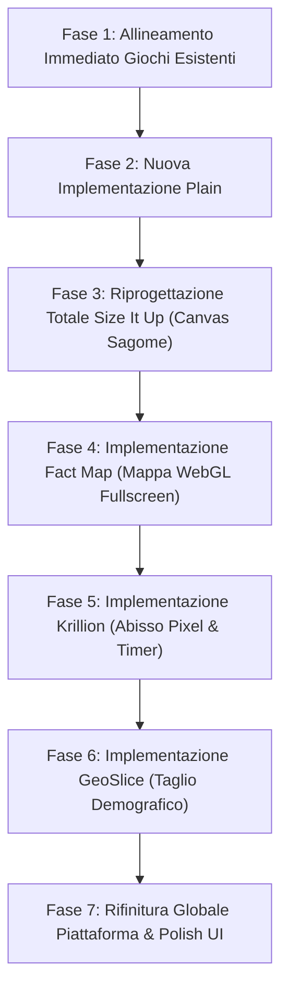

# Piano di Implementazione e Roadmap di Allineamento Piattaforma

**Data:** 2026-10-27  
**Progetto:** Piattaforma Sette Giochi (`~/Projects/seven-games-platform`)  
**Obiettivo:** Trasformare l'attuale piattaforma in una suite di sette esperienze curate, distinte, a pieno schermo e fedeli alle meccaniche autentiche verificate tramite reverse engineering REA.

---

## 1. Stato Attuale della Piattaforma Locale

Dall'audit del codice sorgente (`src/`) e della documentazione, la piattaforma locale si trova in questo stato:

- **Infrastruttura condivisa pronta:**
  - Router (`@/app/router/router.tsx`) con navigazione e rotte per ciascun gioco.
  - Sistema di persistenza locale (`@/services/persistence.ts` con LocalStorage, tracking partite giornaliere, streak e storico).
  - Gestione audio (`@/lib/sound.ts` con Web Audio API per click, fanfare, successo ed errore).
  - Design tokens e utility (`Tailwind CSS v4`, `lucide-react`, `clsx`, `fast-check` per test property-based).
- **Stato dei singoli giochi:**
  - `gazillion`: **Playable (Alta fedeltà matematica)** — Formula autentica già implementata e testata con vitest. Timeline a doppia maniglia funzionante.
  - `estimania`: **Playable (Media fedeltà)** — Gioco funzionante a 5 round con domande numeriche, ma formula di punteggio e palette colori non allineate all'originale.
  - `size-it-up`: **Playable (Bassa fedeltà — MECCANICA ERRATA)** — Attualmente implementato come quiz a scelta multipla A/B ("Quale è più grande?"), mentre l'originale è un **manipolatore 2D a silhouette su canvas**.
  - `plain`: **Planned** — Presente nei metadati del registry, nessun componente o motore implementato.
  - `fact-map`: **Planned** — Presente nei metadati del registry, nessun componente mappa o motore implementato.
  - `krillion`: **Planned** — Presente nei metadati del registry, nessun componente o motore implementato.
  - `geoslice`: **Planned** — Presente nei metadati del registry, nessun componente o motore implementato.

---

## 2. Differenze Chiave Riscontrate e Azioni Correttive Necessarie

### 2.1 Gazillion (`src/games/gazillion/`)

- **Differenze riscontrate:**
  - La formula matematica e i test sono già allineati al 100% all'evidenza REA.
  - Manca la modalità `Practice` (attualmente solo Daily).
  - La timeline visiva è essenziale: mancano i marcatori delle ere geologiche/cosmiche (`MODERN ERA 🏙️` ... `BIG BANG 💥`) e l'animazione del dinosauro viaggiatore nel tempo.
- **Azioni correttive:**
  - Aggiungere la modalità di prova libera non a tempo (`Practice`).
  - Aggiornare `Timeline.tsx` aggiungendo i marker iconici delle ere e l'etichetta dell'era dell'evento corrente.
  - Aggiungere il micro-mascotte dinosauro nel feedback di round.

### 2.2 Estimania (`src/games/estimania/`)

- **Differenze riscontrate:**
  - Formula locale non autentica: usava una percentuale lineare/quadratica anziché la formula logaritmica ufficiale ratio-based.
  - Identità cromatica disallineata: associata ad arancio/ambra nel registry anziché all'autentico **Teal profondo (`#0d9488`)**.
  - Spiegazione didattica assente o minimale dopo il round.
- **Azioni correttive:**
  - Sostituire in `engine.ts` la formula con:
    $$\text{score} = \max\left(0, \operatorname{round}\left(100 \times \left(1 - \left|\log_{10}\left(\frac{\text{guess}}{\text{answer}}\right)\right|\right)\right)\right)$$
  - Impostare l'accento colore su `teal-600` e sfondo caldo pietra `stone-100`.
  - Inserire in `questions.ts` il campo `explanation` e `source` per ogni fatto stimato.

### 2.3 Size It Up (`src/games/size-it-up/`) — RIFACIMENTO CRITICO

- **Differenze riscontrate:**
  - **Completamente disallineato dalla vera natura del gioco:** Da quiz testuale A/B a gioco interattivo visuale di ridimensionamento sagome su Canvas.
- **Azioni correttive:**
  - Riprogettare il componente `SizeItUpGame.tsx` basandolo su un canvas interattivo (o elemento SVG bidimensionale responsive) con due sagome:
    - Sagoma blu fissa (Riferimento con dimensione reale nota).
    - Sagoma rossa interattiva (Target ridimensionabile trascinando una maniglia o con slider di scala).
  - Implementare la regola del 6% di tolleranza per ottenere 100 punti.
  - Aggiungere pulsanti di zoom in/out e "Fit both".
  - Costruire un dataset iniziale di sagome vettoriali SVG per 20–30 oggetti di uso comune, animali ed edifici.

### 2.4 Plain (`src/games/plain/`) — NUOVA IMPLEMENTAZIONE

- **Caratteristiche da implementare:**
  - Tema dark mode moderna (`#0b0d12`) con accento lime neon (`#d2fa4b`) e font `Geist` o sans-serif geometrico.
  - Metafora della quota aerea: obiettivo scalare 5.000 metri in 7 round.
  - Input numerico rapido con tasto Enter.
  - Feedback immediato con percentuale di scostamento (`X% under` / `X% over`) e quota guadagnata (`+X m`).
  - Curiosità educativa con fonte per ogni risposta.

### 2.5 Fact Map (`src/games/fact-map/`) — NUOVA IMPLEMENTAZIONE

- **Caratteristiche da implementare:**
  - Layout a tutto schermo con mappa interattiva (`MapLibre GL` o `Leaflet` con tile vector/raster puliti e senza etichette spoiler).
  - Spillo posizionabile con click/tap e zoom fluido.
  - HUD superiore con domanda, indicazione di scala (`Aim for a city/country`) e pulsante Indizio (-250 pt).
  - Reveal con linea geodesica tra guess e bersaglio reale, calcolo della distanza in km e curva di punteggio (1.000 pt max).

### 2.6 Krillion (`src/games/krillion/`) — NUOVA IMPLEMENTAZIONE

- **Caratteristiche da implementare:**
  - Estetica terminale oceanico retrò con font pixel `VT323` e profondimetro (0–7.000 m).
  - 7 prompt a risposta aperta con timer a 25 secondi.
  - Motore di rarità euristico locale: tabella di risposte valide classificate nei 6 tier (Plankton 10pt, Too Clever 15pt, Schooler 30pt, Rare 60pt, Deep Cut 85pt, One in a Krillion 100pt).
  - Tolleranza ortografica e suggerimento typo ("Intendevi...?").

### 2.7 GeoSlice (`src/games/geoslice/`) — NUOVA IMPLEMENTAZIONE

- **Caratteristiche da implementare:**
  - Mappa tematica scura con heatmap di densità demografica.
  - Overlay SVG con linea di divisione e maniglie di trascinamento/rotazione per le modalità `Halves` (50/50), `Thirds` (120°) e `Quarters` (croce a 90°).
  - Motore di calcolo popolazione: modello vettoriale a poligoni/punti con popolazioni demografiche pre-calcolate (senza dipendere da pesanti backend GIS raster esterni).

---

## 3. Piano di Lavoro Ordinato per Priorità

### Priorità 1 (Immediata): Allineamento e Perfezionamento Giochi Esistenti

1. **Estimania:**
   - Aggiornare `engine.ts` con la formula logaritmica reale certificata.
   - Aggiornare i test unitari in `estimania.test.ts`.
   - Aggiornare i colori in `theme.ts` e `registry.ts` a Teal (`#0d9488`).
   - Aggiungere testi di approfondimento culturale in `data/questions.ts`.
2. **Gazillion:**
   - Introdurre la modalità `Practice` in `GazillionGame.tsx`.
   - Arricchire l'estetica di `Timeline.tsx` con le icone delle ere storiche e geologiche.

### Priorità 2: Implementazione di Plain (Gameplay numerico a quota aerea)

- Creare `src/games/plain/`:
  - `types.ts`, `engine.ts`, `generator.ts`, `data/prompts.ts`, `PlainGame.tsx`.
  - Design dark mode con contrasto lime neon (`#d2fa4b`).
  - Quota target: 5.000 metri in 7 round.
  - Test completi con vitest.

### Priorità 3: Riprogettazione Radicale di Size It Up (Canvas Silhouette 2D)

- Sostituire il modello a quiz A/B con il vero gameplay visivo:
  - Componente Canvas o SVG manipolabile con coordinate relative.
  - Asset library SVG con 30 oggetti/animali/edifici in scala nota.
  - Sistema di ridimensionamento interattivo e tolleranza 6% per il massimo punteggio.
  - Pulsante zoom in/out e "Fit both".

### Priorità 4: Implementazione di Fact Map (Mappa Geografica WebGL)

- Creare `src/games/fact-map/`:
  - Integrazione MapLibre GL o Leaflet con tile vector/raster puliti e neutri.
  - HUD a schermo intero con overlay per domanda, target di scala e indizio (-250 pt).
  - Tracciamento linea geodesica e calcolo distanza in km.
  - Dataset di 50+ fatti storici, geografici e culturali con coordinate precise.

### Priorità 5: Implementazione di Krillion (Retro-Abisso a Risposta Rara)

- Creare `src/games/krillion/`:
  - Stile visivo dedicato con font `VT323`, sfondo marino scuro e profondimetro fino a 7.000 m.
  - Timer a 25 secondi con animazione di affondamento nei 6 tier.
  - Dataset curato con 30+ categorie e dizionario delle risposte con tier di frequenza pre-assegnati.
  - Riconoscitore di typo con distanza di Levenshtein.

### Priorità 6: Implementazione di GeoSlice (Sezionamento Demografico)

- Creare `src/games/geoslice/`:
  - Mappa scura con layer di densità abitativa demografica.
  - Controller vettoriale SVG a maniglie per dividere la regione in 2, 3 o 4 porzioni.
  - Algoritmo di calcolo popolazione punto-in-poligono su dataset geografico vettoriale leggero.

### Priorità 7: Polish Generale e Coerenza della Piattaforma

- Verifica responsive su mobile, tablet e desktop ultra-wide per tutti e 7 i giochi.
- Audio mixer globale (mute memorizzato in LocalStorage).
- Dashboard unificata con carosello o griglia tematica dove ogni card esprime la personalità del rispettivo gioco.
